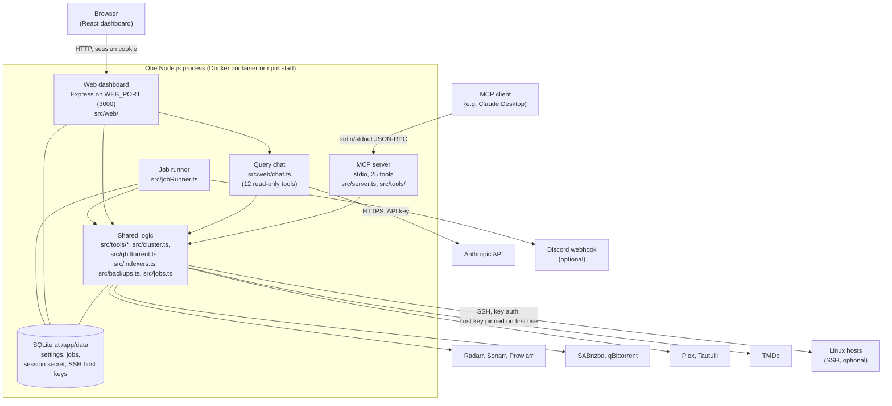

# Architecture

Plex Director is a self-hosted assistant for a Plex + Servarr media stack. This page describes its parts,
who and what talks to them, what each can do, and how a request flows through. For what this means for
security, see [security.md](security.md) and the [assurance case](assurance-case.md). Every external
interface is listed in [interfaces.md](interfaces.md).

## Components

| Component | Code | Responsibility |
| --- | --- | --- |
| **MCP server** | `src/index.ts`, `src/server.ts`, `src/tools/` | Speaks the Model Context Protocol over stdin/stdout using the official MCP SDK. Registers 25 tools: searching the library, diagnosing missing media, adding movies, download and indexer health, batch jobs, host monitoring and backups. Tool arguments are validated with zod schemas by the SDK before a handler runs. |
| **Web dashboard** | `src/web/app.ts`, `src/web/auth.ts`, `src/web/routes/` | An Express 5 server on `WEB_PORT` (default 3000). Serves the built React app from `web/dist` and a JSON API under `/api`. With `WEB_PASSWORD` set, every `/api` route except `/api/auth/*` needs a signed session cookie. The API is described in [api/openapi.json](api/openapi.json). |
| **Frontend** | `web/` (React, TypeScript, Vite, Radix Themes) | A single-page app: Query (chat), Server Status, Node Utilization, Queues, Indexers, Jobs and Settings. It holds no secrets; everything comes from `/api`. Plex and Tautulli artwork is loaded through server-side proxies so the Plex token and Tautulli key never reach the browser. |
| **Query chat** | `src/web/chat.ts`, `src/web/routes/chat.ts` | Sends the user's question, a bounded slice of chat history (12 turns, 4,000 characters each) and the 12 read-only tools in `movieTools` to the Anthropic API, runs the tools the model asks for (at most 4 rounds; each tool checks the model's arguments against its zod schema first), and returns the answer text, any images and the rows for the results table. The chat cannot add, delete or start anything. |
| **Shared logic** | `src/tools/*.ts`, `src/cluster.ts`, `src/qbittorrent.ts`, `src/indexers.ts`, `src/backups.ts`, `src/jobs.ts` | Each capability is written once and used by both surfaces: `movieTools` in `src/tools/movies.ts` backs both the MCP tools and the chat; the SSH probe, qBittorrent session handling and Prowlarr health are shared by the MCP tools and the dashboard routes. |
| **Service clients** | `src/clients.ts`, `src/settings.ts` | One axios client per service (10-second timeout), configured from the settings store and refreshed in place whenever the Settings page saves. |
| **Job runner** | `src/jobRunner.ts`, `src/jobs.ts` | Every `JOB_RUNNER_INTERVAL_SECONDS` (default 60, minimum 10, 0 turns it off) advances one item of one `RUNNING` job: one Radarr movie search. Steps are claimed in the database before the search is sent, so two processes sharing the database never search the same movie twice. Three failures in a row pause the job and send a Discord notification. |
| **SSH monitoring** | `src/ssh.ts`, `src/cluster.ts`, `src/hostKeys.ts` | Connects to each host in `UBUNTU_HOSTS` with a private key file (`SSH_KEY_PATH`), runs one fixed, read-only telemetry script, and parses the output. Each host's key fingerprint is remembered on first contact; a different key is refused before any command is sent. |
| **Settings and state** | `src/db.ts`, `src/settings.ts` | A SQLite database (`better-sqlite3`) at `data/plex_director.db`, `/app/data` in the container. Tables: `settings` (service URLs and credentials, and the session-signing secret), `system_jobs`, `interaction_context` (the last movie-choice grid) and `ssh_host_keys`. Environment variables only seed service settings on first boot; after that the database wins. |

## Actors and what they can do

| Actor | Reaches Plex Director through | Can do |
| --- | --- | --- |
| **Dashboard user** | A browser on the LAN, port 3000, signed in with `WEB_PASSWORD` (or anyone who can reach the port when it is unset) | Read status, queues, indexers, host health and jobs; ask the Query chat (read-only tools); view and change service settings (secrets are write-only); approve a changed SSH host key with **Trust new key**. Cannot start, pause or cancel jobs, add movies or delete downloads. |
| **MCP client** (e.g. Claude Desktop) | The process's stdin/stdout, launched by the client on the same machine | Call any of the 25 tools, including the ones that change things: add movies to Radarr and start searches (`confirm_selected_choices`), delete stalled torrents and their files (`manage_stalled_downloads` with `PURGE_STALLED`), plan, start, pause and cancel batch jobs, and trigger Servarr backups. The client asks the user before each tool call. |
| **The LLM** | Indirectly: the Anthropic model in the Query chat, or whichever model drives the MCP client | Chooses which tools to call and with which arguments. In the Query chat it can only use the 12 read-only tools. Through an MCP client it can request any tool, subject to that client's approval prompts. |
| **External services** | Plex Director calls them; they never call in | Return data (titles, summaries, torrent names, indexer messages, host command output) that is shown to users and given to the LLM. A compromised or malicious service controls that data. |
| **Maintainer and CI** | GitHub: pull requests to protected `main`, GitHub Actions | Change the code, publish signed images to Docker Hub and GHCR, cut releases. See [dependencies.md](dependencies.md). |

## How a request flows

**A question in the Query chat**

1. The browser posts the question and recent history to `POST /api/chat/movies`. `requireAuth`
   (`src/web/auth.ts`) checks the session cookie when `WEB_PASSWORD` is set.
2. `parseHistory` (`src/web/routes/chat.ts`) keeps only well-formed `{role, text, media}` entries;
   `buildHistoryMessages` (`src/web/chat.ts`) caps them at 12 turns of 4,000 characters.
3. The server calls the Anthropic API with a fixed system prompt and the 12 read-only tool definitions.
4. For each tool the model asks for, the matching handler in `movieTools` runs and queries Plex, Radarr,
   Sonarr, SABnzbd or TMDb. Results go back to the model, for at most 4 rounds.
5. The answer text, images and table rows are returned to the browser, which renders text as plain React
   elements (no HTML, no links) and posters through `/api/plex/image`.

**A tool call from Claude Desktop**

1. Claude Desktop starts the container (`docker run -i`) or `tsx src/index.ts` and talks JSON-RPC over
   stdin/stdout. Nothing else is written to stdout (logs go to stderr, and `dotenv` is kept quiet).
2. The MCP SDK validates the arguments against the tool's zod schema and runs the handler.
3. The handler calls the services with the stored credentials and returns text (and sometimes images or
   structured rows).

**A batch job**

1. `plan_media_upgrade` lists Radarr movies with no file or below 1080p and stores up to `maxBatchSize`
   (default 25, at most 100) movie ids as a `PENDING` job. TV is refused by design.
2. Nothing runs until `update_job_status` with `RESUME` sets it to `RUNNING`.
3. The job runner claims one item per tick, sends one Radarr `MoviesSearch`, and marks the job
   `COMPLETED` (with a Discord notification) after the last item, or `PAUSED` after three failures.

## Deployment shape

- **One container, one process.** The published image (`honeybeartech/plex-director-mcp`,
  `ghcr.io/honeybeartech/plex-director-mcp`) runs `dist/index.js` on a distroless Node.js 24 base with no
  shell or package manager. It starts the MCP server on stdio, the dashboard on `WEB_PORT`, and the job
  runner, all in the same process.
- **Two common ways to run it:** a long-lived Compose service for the dashboard, and, for Claude Desktop,
  a short-lived `docker run -i --rm` that Claude starts. Both should mount the same `/app/data` so they
  share settings and job history; the job claim in `src/jobs.ts` makes that safe.
- **On the LAN, next to the services.** It is designed for a trusted home network. It does not terminate
  TLS; put a reverse proxy in front if you reach it from elsewhere.
- **State is one SQLite file** in the data volume. The image's built-in health check calls `GET /healthz`.
- Multi-arch images (`linux/amd64`, `linux/arm64`) are built, smoke-tested and signed with cosign by
  `.github/workflows/ci.yml`.

## Key properties

- **Register once, share everywhere.** A capability lives in one module and is used by both the MCP tools
  and the dashboard, so the two cannot drift apart.
- **Secrets stay on the server.** The Settings API never returns a stored secret, only whether it is set;
  artwork is proxied; the SSH key path is env-only and never stored or shown.
- **Changes need a person.** Jobs never start on their own, the dashboard cannot start or control them,
  and the chat has no tools that change anything.
- **Rate-limited bulk actions.** The job runner sends at most one Radarr search per interval across all jobs.
- **Boots with no configuration.** Every service is optional; an unconfigured one simply reports that.

## Technology

Backend: Node.js 24, TypeScript, Express 5, express-rate-limit, the official MCP SDK
(`@modelcontextprotocol/sdk`), the Anthropic SDK (`@anthropic-ai/sdk`), axios, better-sqlite3, ssh2, zod
and dotenv (`package.json`, `package-lock.json`). Frontend: React 19, TypeScript, Vite, Radix Themes,
React Router (`web/package.json`, `web/package-lock.json`). Tests use Node's built-in test runner.
Deployment: a multi-stage Dockerfile with digest-pinned base images.
